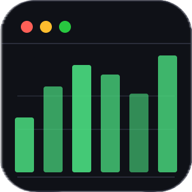
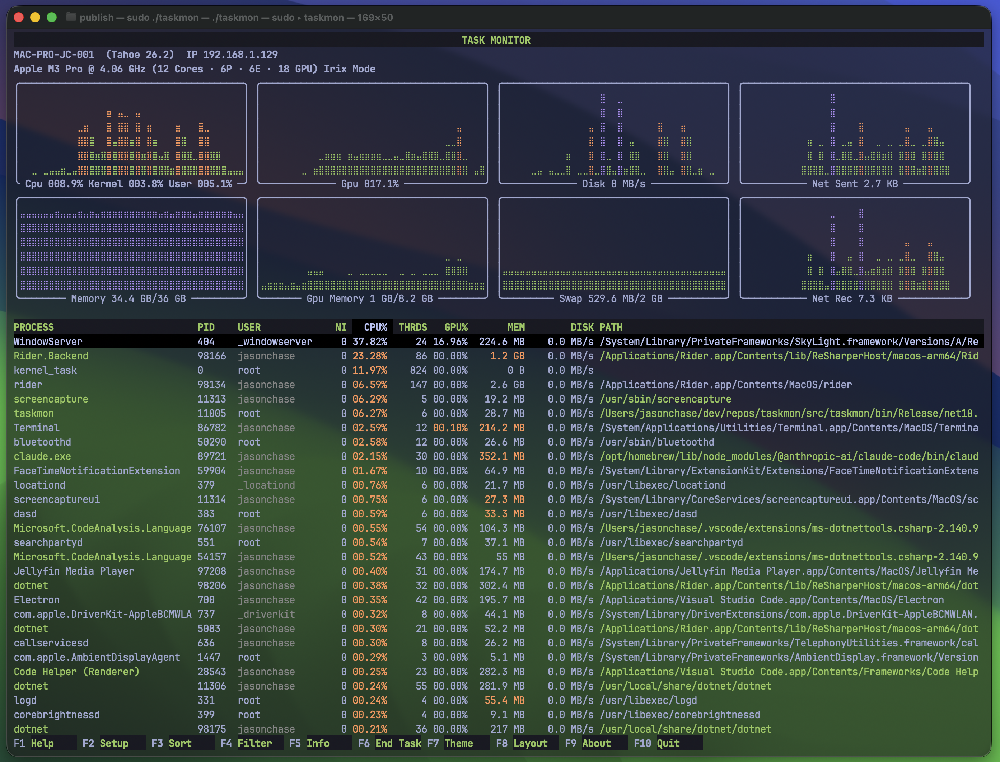
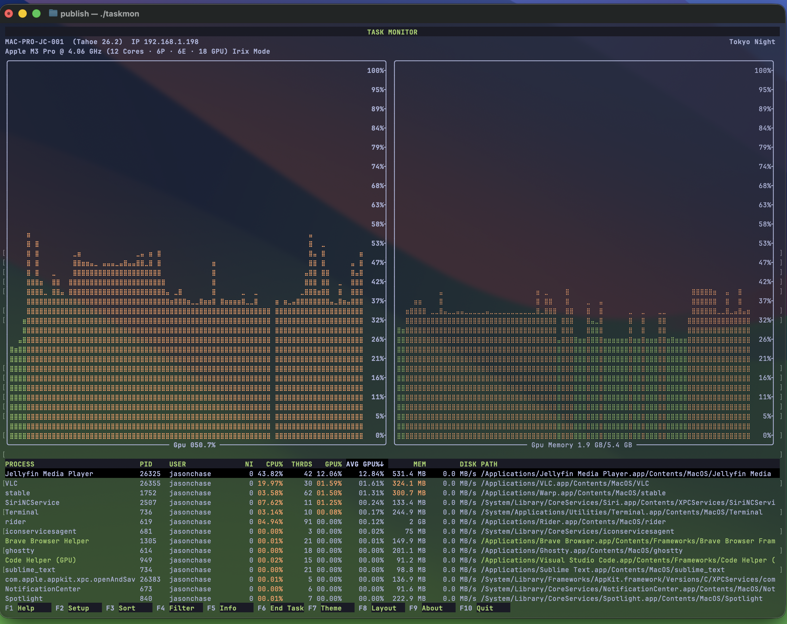

<h1>
  
  Task Monitor
</h1>
<p>A modern, powerful cross-platform terminal-based task monitor providing real-time monitoring and management of a computer's performance, active processes, and resource utilization. Perfect for Homelab and local LLM monitoring. 
Originally inspired by tools like <b>top</b>, <b>htop</b> and the <b>Windows Task Manager</b>, it provides performance monitoring at-a-glance for system resources (including CPU, GPU, Memory, Swap, Disk and Network) and process management functions.</p>

[](#macos-on-apple-silicon)
[](#windows-on-x64-and-arm64)

[](#macos-on-apple-silicon)
[](#windows-on-x64-and-arm64)
[](#linux-distros)






## Features

- **Perfect for HomeLab and Local LLM monitoring**
- **No sudo or administrator privilege required** 
- **Real-Time System Monitoring**: Live updates of CPU, GPU, memory, swap, disk I/O and Network I/O.
- High resolution charts in 24-bit color.
- Switch layouts (`F8`) to focus charts on specific system metrics. 
- **Real-Time Process Monitoring**: View Process, Pid, CPU%, Avg CPU%, Max CPU%, Threads, GPU%, Avg GPU%, Max GPU%, Memory, Avg Memory, Max Memory, Disk MB/s, Avg Disk MB/s, Max Disk MB/s and Command Path.
- Process list formatted similar to the original **htop** and **top**. 
- Process CPU% defaults to Irix mode (individual core saturation) for *nix systems (`i` to toggle on/off).
- Process deep dive (`F5`) to view live thread times and loaded libraries (system and user).
- **Module Analysis**: Full dynamic and static library enumeration for selected process.
- Customize update interval (default 1500ms).
- Customize number of process iteration loops.
- Filter the process list (`f`) and freeze process list updates (`z`).
- **Windows Services**: Show service names and startup parameters, not just generic `svchost.exe` entries. In the `SERVICES` menu, `Space` starts a stopped service or stops a running one at once; there is nothing to save. A ticked service is running or starting, an unticked one stopped or stopping. Most services need taskmon running as administrator, and a service with running dependents, or one that refuses a stop request, is left running and the reason shown.
- Multiple process selection (`x` toggle show checkboxes, `spacebar` for selection, `u` to uncheck all selections)
- Select and terminate multiple processes simultaneously (`F6`).
- Filter by process name, username, command path or PID (`F4`).
- Sort the process list by any visible column (`F3`).
- Quick sort by CPU%, GPU% or Memory (`p`, `g` or `m` respectively). 
- Toggle process sorting between ascending (using the `a` key) and descending (using the `d` key).
- Navigate scrollable lists using the &#x2193;, &#x2191; arrow keys and `Pg Up` and `Pg Down` keys.  
- **Multiple Themes**: Ships with dozens of popular, modern 24-bit color themes.
- Modern terminal detection to support color desaturation.
- **Customize Configuration**: Manage configuration settings using the (`F2`) Setup function. Interactive UI for modifying and saving settings.
- **System profile**: Display machine name, OS name and version, CPU name and clock speed, top resource consumers (Avg and Max) (using the `F9` function).
- **System Info**: Full hardware and OS specification dump - machine, OS, CPU, every memory module, GPU, Neural Engine (macOS), physical disk (with volumes) and network adapter - in one scrollable screen (`SYSTEM INFO` menu).
- **Startup**: Lists the applications configured to run at logon - on Windows the `Run` / `RunOnce` registry keys, the per-user and all-users Startup folders, and scheduled tasks that run at logon or boot; on macOS the Open at Login items, app login helpers, and launch agents and daemons - with each entry's publisher, type, enabled/disabled state and command (`STARTUP` menu). `Space` enables or disables the selected entry at once, as Task Manager does; there is nothing to save. On Windows, machine-wide entries, and most scheduled tasks, need taskmon running as administrator, and `RunOnce` entries can't be disabled. On macOS the change is a launchd override (`launchctl enable` / `disable`), so it takes effect at the next login or boot: launch daemons need sudo, Open at Login items are changed in System Settings, and an item whose *Allow in the Background* switch is off in System Settings must be allowed there first. System Settings doesn't show launchd overrides, so its switch stays on for an item taskmon has disabled.
- **Thermals**: Live temperature charts for every sensor the machine reports without a kernel driver - NVMe / SATA drives (SMART), NVIDIA (NVAPI) and AMD (ADL) GPUs, and the ACPI thermal zones - on a dedicated `THERMALS` screen, with the current reading also shown on the CPU, GPU and Disk performance panels. Accurate CPU die temperature needs a signed kernel helper driver and is not read.
- **Power**: GPU power draw (NVIDIA via NVML, AMD via ADL) and an NVMe drive's rated peak appear on the respective performance panels; whole-system power is read while on battery. A qualitative power-usage rating (`Very Low` … `Very High`, like Task Manager) is available as a process-list column. Per-process watts and CPU package power need a kernel driver and are not read.
- **Health at a glance**: The footer shows the highest level in the `HEALTH` view (OK, Warning or Critical) in its status colour.
- **About**: `F12` shows the version and whether Task Monitor is running as administrator (root on macOS), how long its sampling engine has run, how often it samples, how many samples have arrived and how fresh the last one is, and each of its samplers with a dot in the colour of its status (a sampler that isn't running also says whether it is starting, stopped or errored). On a smaller window the sampler list goes first, then the figures. `C` copies all of that, with the runtime, the terminal and where Task Monitor keeps its settings, health history and logs, to the clipboard, ready to paste into a bug report.
- **Health**: Shows which part of the machine is under pressure and why (`HEALTH` menu). Each resource is rated OK, Warning or Critical on how busy it is, how much work is waiting for it and any errors, with the processes most likely behind it and a history of recent events. Windows that stop responding are shown as they happen, and crashes, hangs and hardware errors the system recorded in the last 24 hours are listed alongside. Press `Enter` on a likely cause to open that process. All thresholds can be changed in `taskmon.ini`.
- **Languages**: British English (the default), US English, Brazilian Portuguese, Danish, Dutch, French, German, Italian, Polish and Spanish, picked from your system settings or chosen in Setup. See [Language](#language).

**Cross-Platform Native Performance**
- Platform-specific optimizations using C APIs (Win32,  Mach kernel). 
- .net native build with small memory footprint.
- Zero third-party dependencies on libraries such as ncurses.

## Installation

Note: taskmon does NOT require the .net SDK or runtime to be installed on any platform to run. The application is a native-code, self-contained executable on all platforms.

### macOS on Apple Silicon

[](#macos-on-apple-silicon)
The easiest way to install on macOS ARM64 (Apple Silicon) is using homebrew:

```bash
brew tap jchas2/taskmon
brew trust jchas2/taskmon
brew install taskmon
```

To update to the latest version:

```bash
brew update
brew upgrade taskmon
```

Task Monitor does not require sudo permission on MacOS for system monitoring, however some system process detail won't be available unless run with sudo.

### Windows on x64 and ARM64

[](#windows-on-x64-and-arm64)
The easiest way to install on Windows is using chocolately (pending):

```powershell
choco install taskmon
```

To update to the latest version:

```powershell
choco upgrade taskmon
```

### Windows (Direct Download)

- [Windows x64](https://github.com/jchas2/taskmon/releases/latest)
- [Windows ARM64](https://github.com/jchas2/taskmon/releases/latest)

After downloading:
1. Extract the archive
2. Run PowerShell or Command Prompt, then run `.\taskmon.exe`

Task Monitor does not require elevated permission on Windows for system monitoring, however some system process detail won't be available unless run as Administrator.

### Linux Distros

Task Monitor is not yet available on Linux (coming soon).

## Usage

Task Monitor supports the following commands on startup. Note these commands can also be configured using the F2 Setup function, and saved to configuration for next run.

| Command | What it does |
|---------|--------------|
| `taskmon` | Start Task Monitor with configuration defaults. |
| `taskmon --gpu-only` | Automatically monitor GPU resources on startup. |
| `taskmon --cpu-only` | Automatically monitor CPU resources on startup. |
| `taskmon --pid <pid>` | Automatically monitor the pid nnn on startup. |
| `taskmon --username <username>` | Automatically monitor all processes running under user username on startup. |
| `taskmon --process <processname>` | Automatically monitor all processes with matching processname on startup. |
| `taskmon --delay <delay>` | Use <delay> in milliseconds between chart and process updates. |
| `taskmon --theme <theme>` | Load a theme <theme> from the available themes. Eg: `taskmon --theme "Dracula Official"` |
| `taskmon --theme-help` | Show the list of theme names available for the `--theme` option. |
| `taskmon --debug` | Signal a debug break on startup and wait for a debugger to attach. |
| `taskmon --version` | Print version information and exit. |
| `taskmon --help` | Show help and usage information. |

## Configuration

Task Monitor stores configuration and log files in the following system directories:

| Config | Description |
|--------|-------------|
| `taskmon.ini` | Primary config file in .ini format. |
| Theme files | One file per custom theme. Copies of the built-in themes are kept in its `built-in` folder. |
| Layout files | One file per custom SUMMARY layout. Copies of the built-in layouts are kept in its `built-in` folder. |
| Log files | One log file per session; logs are rotated > 2MB and routinely deleted. |
| Event files | One .ini file per `HEALTH` event, reloaded into Recent events at startup. The oldest are deleted once there are more than `event-history-size`. |

### MacOS

| Config | Path |
|--------|------|
| `taskmon.ini` | `~/.config/taskmon/v2` |
| Theme files | `~/.config/taskmon/v2/themes` |
| Layout files | `~/.config/taskmon/v2/layouts` |
| Log files | `~/Library/Logs/taskmon` |
| Event files | `~/Library/Logs/taskmon/Events` |

### Windows

| Config | Path |
|--------|------|
| `taskmon.ini` | `~\AppData\Roaming\taskmon\v2` |
| Theme files | `~\AppData\Roaming\taskmon\v2\themes` |
| Layout files | `~\AppData\Roaming\taskmon\v2\layouts` |
| Log files | `~\AppData\Local\taskmon\Logs` |
| Event files | `~\AppData\Local\taskmon\Events` |

The files directly in the `taskmon` folder, outside `v2`, belong to version 1. See [Upgrading from version 1](#upgrading-from-version-1).

### Built-in themes and layouts

The built-in themes and layouts are part of the program. Each time Task Monitor starts it writes a copy of each one to the `built-in` folder inside `themes` and `layouts`, for reference and for copying, and deletes any other theme or layout file it finds there. It never loads those copies, so changes made to them are lost.

Your own themes and layouts go in `themes` and `layouts` themselves, and Task Monitor only writes there when you save a layout from the Layout Designer. A theme or layout is named by its `[header]`, not its file name. The names of built-in themes and layouts are reserved: a file whose header uses one is skipped, and the Layout Designer won't save a layout under one.

Every theme and layout file starts its section with `version=2`, the version of its format. A file without it, or with another version, is skipped, and the log says which file and why.

### Upgrading from version 1

Version 2 starts with its default settings, and doesn't read or change anything version 1 saved. Version 1's `taskmon.ini`, `themes` and `layouts` stay as they were in the `taskmon` folder, outside `v2`, so going back to version 1 finds them untouched. Once you no longer need version 1, you can delete them. Logs and event files stay where they were.

- **Settings**: choose them again in Setup (`F2`).
- **Custom layouts**: version 2's layouts are a different format, so build them again in the Layout Designer.
- **Custom themes**: version 2 renamed the theme keys, and has many more. To bring a version 1 theme across, copy a theme from `themes\built-in` into `themes`, give it a new name and header, and copy your colours across using the table below. `colour-mode` is unchanged.

| Version 1 key | Version 2 key |
| :--- | :--- |
| `background` | `control.background` |
| `background-highlight` | `control.background.highlight.focused` |
| `col-cmd-high-cpu` | `process.list.highcpu` |
| `col-cmd-io-bound` | `process.list.iobound` |
| `col-cmd-low-priority` | `process.list.lowpriority` |
| `col-cmd-normal-user-space` | `process.list.normaluserspace` |
| `col-cmd-script` | `process.list.script` |
| `col-user-current-non-root` | `process.list.user.currentnonroot` |
| `col-user-other-non-root` | `process.list.user.othernonroot` |
| `col-user-root` | `process.list.user.root` |
| `col-user-system` | `process.list.user.system` |
| `command-background` | `command.background` |
| `command-foreground` | `command.foreground` |
| `delta-highlight-colour` | `process.list.deltahighlight` |
| `error` | `app.error` |
| `foreground` | `control.foreground` |
| `foreground-highlight` | `control.foreground.highlight.focused` |
| `header-background` | `listview.header.background` |
| `header-foreground` | `listview.header.foreground` |
| `menubar-background` | `menubar.background` |
| `menubar-foreground` | `menubar.foreground` |
| `range-high-background` | `chart.range.high.background` |
| `range-high-foreground` | `chart.range.high.foreground` |
| `range-low-background` | `chart.range.low.background` |
| `range-low-foreground` | `chart.range.low.foreground` |
| `range-mid-background` | `chart.range.mid.background` |
| `range-mid-foreground` | `chart.range.mid.foreground` |

### Editing taskmon.ini

`taskmon.ini` can be edited by hand. Task Monitor creates it the first time it starts, with a comment above each setting saying what it does and showing its default. Saving from Setup (`F2`) only changes the settings changed there, so comments (lines starting with `;` or `#`), blank lines, ordering and edits made while Task Monitor is running are all kept. Settings added by a new version are added to the end of their section, with their comment, the next time Task Monitor starts, and the previous file is kept as `taskmon.ini.bak`.

If the file can't be read, Task Monitor starts with its default settings and leaves the file alone. Saving from Setup then shows the line at fault, and works again once that line is fixed.

### Language

Task Monitor's screens are in British English by default, and also in US English, Brazilian Portuguese, Danish, Dutch, French, German, Italian, Polish and Spanish.

| Language | Code | Used for |
| :--- | :--- | :--- |
| British English | `en-GB` | The default, and any language without its own translation, such as `en-AU` or `sv-SE`. |
| US English | `en-US` | US English only. |
| Brazilian Portuguese | `pt-BR` | Brazil only. European Portuguese (`pt-PT`) gets British English. |
| Danish | `da` | Danish (`da-DK`). |
| Dutch | `nl` | Any Dutch region, such as `nl-NL` or `nl-BE`. |
| French | `fr` | Any French region, such as `fr-FR`, `fr-CA` or `fr-CH`. |
| German | `de` | Any German region, such as `de-DE`, `de-AT` or `de-CH`. |
| Italian | `it` | Any Italian region, such as `it-IT` or `it-CH`. |
| Polish | `pl` | Polish (`pl-PL`). |
| Spanish | `es` | Any Spanish region, such as `es-ES`, `es-MX` or `es-AR`. |

Task Monitor picks the language when it starts, from the first of these that names one:

1. The `TASKMON_UI_LANGUAGE` environment variable, for a one-off change.
2. The language chosen in Setup, kept as the `ui-language` setting in the `[ux]` section of `taskmon.ini`.
3. Your region, when both it and your display language are English. Windows often has an English (United States) display language on UK and Australian machines, while the region says where you are and so which spelling you'd expect.
4. Your display language on Windows, or the `LANG` environment variable on macOS.

To keep Task Monitor in Italian, press F2 for Setup, choose LANGUAGE, highlight Italiano and press F10. Each language is listed in its own name. Task Monitor shows the new language the next time it starts, as the note under the list says.

Setup saves the choice in `taskmon.ini`, which you can also edit yourself:

```ini
[ux]
ui-language=it-IT
```

`ui-language` is empty by default, which leaves the choice to steps 3 and 4. That is the System default row in Setup, which names the language it gives. A code you set that Setup doesn't list, such as `en-AU`, gets a row of its own, so saving from Setup keeps it.

For a single session, set the environment variable instead. It overrides `ui-language`:

```powershell
# Windows (PowerShell)
$env:TASKMON_UI_LANGUAGE = "it-IT"; taskmon
```

```bash
# macOS
TASKMON_UI_LANGUAGE=it-IT taskmon
```

- Only the text changes. Numbers, dates and times keep following your region settings.
- A code Task Monitor doesn't recognise, such as `italian`, is ignored, and the next step decides.
- `taskmon.ini`, theme files, layout files and log files stay in English whatever the language.
- The log file records the choice at startup, for example `ui-language = it-IT` followed by `UI culture = it-IT, region culture = en-AU`.

### Health Settings

The `[health]` section of `taskmon.ini` holds the thresholds behind the `HEALTH` view, as whole numbers. Changes take effect the next time Task Monitor starts. A value that isn't usable, or a warning and critical pair the wrong way round, falls back to its default.

A resource moves to Warning or Critical after staying over its threshold for the sustain period, so a short spike doesn't raise a status. Brief dips back under the threshold don't restart that period, as a value sitting near a threshold spends some samples either side of it.

| Setting | Default | Description |
| :--- | :--- | :--- |
| `warning-sustain-seconds` | 30 | How long a value must stay over a warning threshold. |
| `critical-sustain-seconds` | 60 | How long a value must stay over a critical threshold. |
| `sustain-grace-seconds` | 5 | How long in total a value can spend the wrong side of a threshold before the sustain or clear period restarts. |
| `clear-seconds` | 30 | How long a value must stay back under a threshold before the status clears. |
| `event-history-size` | 100 | Number of recent events to keep, in the `HEALTH` view and on disk. `0` turns saving them off. |
| `cpu-warning-percent` | 90 | CPU busy time. |
| `cpu-critical-percent` | 98 | CPU busy time. |
| `run-queue-warning-per-core` | 2 | Threads waiting per core on Windows, load average per core on macOS. |
| `run-queue-busy-percent` | 50 | The queue only counts with the CPU at least this busy, as the macOS load average keeps falling for over a minute after work ends. |
| `driver-time-warning-percent` | 15 | CPU time in drivers (Windows, DPC and interrupt time). |
| `memory-available-warning-percent` | 10 | Memory available (Windows). macOS uses the kernel's own pressure level. |
| `memory-available-critical-percent` | 5 | Memory available (Windows). |
| `commit-warning-percent` | 90 | Commit charge against the commit limit (Windows). |
| `commit-critical-percent` | 97 | Commit charge against the commit limit (Windows). |
| `hard-faults-warning-per-second` | 500 | Pages read from disk per second to resolve hard faults (Windows), shown as pages in/s. |
| `hard-faults-available-percent` | 25 | Hard faults only count with this much memory available or less, as Windows also reads pages back in when memory is plentiful. |
| `swap-out-warning-mb-per-second` | 0 | Swap-out rate that counts as a warning (macOS). |
| `disk-latency-warning-ms` | 20 | Time for a disk transfer, on the slowest disk. |
| `disk-latency-critical-ms` | 100 | Time for a disk transfer, on the slowest disk. |
| `disk-active-warning-percent` | 90 | Disk active time, used only when latency can't be read. |
| `volume-free-warning-percent` | 10 | Free space on a volume. Read-only volumes are ignored, as they can't be cleaned up. |
| `volume-free-critical-percent` | 5 | Free space on a volume. |
| `system-volume-free-critical-gb` | 2 | Free space on the system volume, whatever its size. |
| `gpu-memory-free-warning-percent` | 10 | Memory free on the fullest GPU: a discrete card's own VRAM, or an integrated GPU's dedicated and shared memory together. |
| `sensor-warning-margin-celsius` | 10 | Distance from a sensor's critical limit, for sensors that report one. |
| `sensor-critical-margin-celsius` | 3 | Distance from a sensor's critical limit. |
| `thermal-pressure-warning` | Moderate | Thermal pressure level (macOS): Nominal, Moderate, Heavy, Trapping or Sleeping. |
| `thermal-pressure-critical` | Heavy | Thermal pressure level (macOS). |
| `performance-limit-warning-percent` | 80 | The share of normal CPU performance the machine is allowed (Windows). Falls when heat, power or a battery setting holds the CPU back. |
| `not-responding-warning-seconds` | 5 | How long a window has been not responding (Windows). Windows takes about 5 seconds to call a window hung, and this counts from there. |
| `not-responding-critical-seconds` | 30 | How long a window has been not responding (Windows). |
| `nvme-wear-warning-percent` | 90 | How much of an NVMe drive's rated life is used (Windows). A drive reporting a critical warning is always Critical. |
| `report-lookback-hours` | 24 | How far back to list crashes, hangs and hardware errors the system recorded. These are listed under Recent events and never change a status. |

## Theme Files

Theme files control the colour palette behaviour for colour desaturation, background opacity, and the colours applied to the TUI screen elements.
Theme files use the ini file format (see example below). To create a custom theme, copy one of the built-in themes from `themes/built-in` into `themes`, give it a new file name and `[header]`, and change the colours as required. Keep its `version=2` line.
Custom themes are available the next time Task Monitor starts. See [Built-in themes and layouts](#built-in-themes-and-layouts) for how the two folders are used.

On the main screen, `F3` switches to the next theme, in the order Setup lists them. The change lasts until Task Monitor exits; to keep it, open Setup (`F2`), where it is already selected, and save.

Below is the start of an example theme file. The copies in `themes/built-in` list every key.
```
;=============================================================================
; Task Monitor (taskmon) - Built-in Theme
;=============================================================================
; IMPORTANT:
; This is a reference copy of a theme built into taskmon. taskmon doesn't
; load it, and puts it back as shipped each time it starts, so any changes
; made here are lost.
;
; How to create a custom theme:
;   Step 1: Copy this file into the themes folder, one level up, under a new
;           name (e.g. "Tokyo Night Custom.theme").
;   Step 2: Rename the header "[Tokyo Night]" to "[Tokyo Night Custom]". A
;           custom theme can't use the name of a built-in theme.
;   Step 3: Change the colours (#RRGGBB, or transparent).
;   Step 4: Keep "version=2". A theme file without it, or with another
;           version, is skipped.
;=============================================================================
[Dracula Official]
version=2
colour-mode=indexed

control.background=transparent
control.background.highlight.focused=#3b5070
control.background.highlight.inactive=#708090
control.foreground=#f8f8f2
control.foreground.highlight.focused=#ffb86c
control.foreground.highlight.inactive=#ffb86c
control.border=#f8f8f2
control.border.focused=#ff79c6

chart.background=transparent
chart.borderforeground=#f8f8f2
chart.borderbackground=transparent
chart.yaxis=#50fa7b
chart.title=#f8f8f2
chart.grid=#A9A9A9
chart.range.low.background=#f1fa8c
chart.range.low.foreground=#000000
chart.range.mid.background=#ffb86c
chart.range.mid.foreground=#000000
chart.range.high.background=#bd93f9
chart.range.high.foreground=#000000
...
```

| Example Theme | Description |
| --- | --- |
| `[Dracula Official]` | Theme name, used to identify the theme. It can't be the name of a built-in theme. |
| `version=2` | The version of the theme file format. A theme file without it, or with another version, is skipped. |
| `colour-mode=indexed` | `Indexed` means use the colour palette that supports colour desaturation on modern terminals. `Truecolour` prevents desaturation (by emitting ARGB) escape codes. `Auto` detects terminal support. |
| `control.background=transparent` | `transparent` honours background colour opacity settings in the terminal. Otherwise specify a custom background colour to override the terminal default. |
| `control.background.highlight.focused=#3b5070` | Row selection background colour in a list. |
| `control.foreground=#f8f8f2` | Text foreground colour. |
| `control.foreground.highlight.focused=#ffb86c` | Row selection foreground colour in a list. |
| `chart.borderforeground=#f8f8f2` | Chart border colour. |
| `chart.yaxis=#50fa7b` | Text colour for chart Y-axis scale. |
| `chart.title=#f8f8f2` | Text colour for a chart's title on its bottom border, including the reading shown with it. If not set, `control.foreground` is used. |
| `chart.grid=#A9A9A9` | Colour of the grid dots drawn behind a chart when the grid is turned on in Setup. |
| `chart.range.high.background=#bd93f9` | Chart colour for high-range values. |
| `chart.range.low.background=#f1fa8c` | Chart colour for low-range values. |
| `chart.range.mid.background=#ffb86c` | Chart colour for mid-range values. |
| `chart.range.high.foreground=#000000` | Text colour for high-range values. |
| `chart.range.low.foreground=#000000` | Text colour for low-range values. |
| `chart.range.mid.foreground=#000000` | Text colour for mid-range values. |
| `listview.header.background=#282a36` | Column header background colour in a list. |
| `listview.header.foreground=#f1fa8c` | Column header foreground colour in a list. |
| `process.list.normaluserspace=#50fa7b` | Text colour for user-mode applications. |
| `process.list.lowpriority=#0000FF` | Text colour for applications running at a low priority. |
| `process.list.highcpu=#bd93f9` | Text colour for a process running at high CPU%. |
| `process.list.iobound=#bd93f9` | Text colour for a process that is IO bound. |
| `process.list.script=#e3b341` | Text colour for script and shell processes. Not used yet: kept for script detection, to come. |
| `process.list.user.currentnonroot=#f8f8f2` | User column colour for the user running Task Monitor. |
| `process.list.user.othernonroot=#f1fa8c` | User column colour for other people's accounts. |
| `process.list.user.system=#ff79c6` | User column colour for system and service accounts: on Windows LOCAL SERVICE, NETWORK SERVICE and service accounts, on macOS the `_`-prefixed accounts. |
| `process.list.user.root=#50fa7b` | User column colour for SYSTEM on Windows and root on macOS. |
| `process.list.deltahighlight=#ffb86c` | Flash colour when a metric updates in the process list. |
| `performance.panel.background=transparent` | Background of the panels down the side of PERFORMANCE. If not set, `control.background` is used. |
| `performance.panel.foreground=#f8f8f2` | Text colour of those panels. If not set, `control.foreground` is used. |
| `performance.panel.titlebar.background=#282a36` | Background of a panel's title strip. If not set, `menubar.background` is used. |
| `performance.panel.titlebar.foreground=#f1fa8c` | Text colour of a panel's title strip. If not set, `menubar.foreground` is used. |
| `app.error=#db61a2` | Text error colour. |
| `status.ok=#f1fa8c` | Status text in lists for running, enabled or OK, e.g. in SERVICES, DRIVERS, STARTUP and HEALTH. If not set, `chart.range.low.background` is used. |
| `status.warning=#ffb86c` | Status text for stopped, disabled or a warning. If not set, `chart.range.mid.background` is used. |
| `status.error=#bd93f9` | Status text for failed or critical. If not set, `chart.range.high.background` is used. |
| `heatmap.state.scanning=#ffb86c` | Text colour of the status line under the DISK SPACE progress metre while a scan runs or is being cancelled. It is drawn on `control.background`. If not set, yellow is used. |
| `heatmap.state.completed=#f1fa8c` | Status line colour when a scan has completed. If not set, green is used. |
| `heatmap.state.faulted=#bd93f9` | Status line colour when a scan has failed. If not set, red is used. |
| `menubar.foreground=#f1fa8c` | Menubar text colour. |
| `menubar.background=#282a36` | Menubar background colour. |
| `command.foreground=#bd93f9` | Function key text colour. |
| `command.background=#282a36` | Function key background colour. |
| `command.foreground.disabled=#808080` | Function key text colour when the key can't be used. |
| `statusbar.banner.background=#3b5070` | Background of the Task Monitor version at the bottom left. If not set, `control.background.highlight.focused` is used, so it looks like a selected row. |
| `statusbar.banner.foreground=#ffb86c` | Text colour of the version. If not set, `control.foreground.highlight.focused` is used. |
| `statusbar.health.ok.background=#f1fa8c` | Background of the health status beside the version when the highest level in HEALTH is OK. If not set, `status.ok` is used. |
| `statusbar.health.ok.foreground=#000000` | Its text colour. If not set, black or white is used, whichever stands out more on the background. The same goes for the other health levels. |
| `statusbar.health.warning.background=#ffb86c` | Background when the highest level is Warning. If not set, `status.warning` is used. |
| `statusbar.health.warning.foreground=#000000` | Its text colour. |
| `statusbar.health.critical.background=#bd93f9` | Background when the highest level is Critical. If not set, `status.error` is used. |
| `statusbar.health.critical.foreground=#000000` | Its text colour. |
| `statusbar.health.unknown.background=#808080` | Background while the level isn't known yet, or when data stops arriving. If not set, `command.foreground.disabled` is used. |
| `statusbar.health.unknown.foreground=#000000` | Its text colour. |
| `statusbar.status.ok=#008000` | Colour of a running sampler's dot on the About screen (`F12`). It is drawn on `control.background`. |
| `statusbar.status.warning=#ffa500` | Dot colour for a sampler that is starting, stopping, stopped or not started. Also the dot beside the footer's health status when data stops arriving. |
| `statusbar.status.error=#ff4500` | Dot colour for a sampler that has failed. |
| `statusbar.pulse=#00bfff` | The dot that blinks as data arrives. |
| `dialog.background=#282a36` | Background of pop-up dialogs, such as the drive picker in DISK SPACE. If not set, `listview.header.background` is used. |
| `dialog.foreground=#f1fa8c` | Text colour in a dialog, including its title. If not set, `listview.header.foreground` is used. |
| `dialog.border=#f1fa8c` | Colour of a dialog's frame. If not set, `listview.header.foreground` is used. |
| `dialog.button.background=#3b5070` | Background of a dialog's OK and Cancel buttons. If not set, `control.background.highlight.focused` is used. |
| `dialog.button.foreground=#ffb86c` | Text colour of the buttons. If not set, `control.foreground.highlight.focused` is used. |
| `dialog.button.focus=#ff0000` | Colour of the first letter of the focused button. If not set, red is used. |
| `dialog.list.background=#1a1b23` | Background of the list or text box inside a dialog. If not set, `listview.background` is used, or `dialog.background` when the list is transparent. |
| `dialog.list.foreground=#f1fa8c` | Text colour of that list or text box. If not set, `listview.foreground` is used, or `dialog.foreground` when the list is transparent. |

Note: ```colour-mode``` can be temporarily overridden for ALL theme files by setting the environment variable ```TASKMON_COLOUR_MODE``` to one of ```Indexed```, ```Truecolour``` or ```Auto```. ```Auto``` will support the theme setting if the terminal supports it.

## Layout Files

Layout files control what SUMMARY shows on the main screen: which charts, metres and lists, and how the screen is split between them. Task Monitor ships with a number of built-in layouts.
The easiest way to make your own is the Layout Designer, from the layouts list in Setup (`F2`), which saves it to the `layouts` folder. A layout file can also be written by hand, or copied from `layouts/built-in` into `layouts` under a new file name and `[header]`, and is available the next time Task Monitor starts.
See [Built-in themes and layouts](#built-in-themes-and-layouts) for how the two folders are used.

On the main screen, `F4` switches SUMMARY to the next layout, in the order Setup lists them, and opens SUMMARY if another view is showing. The change lasts until Task Monitor exits; to keep it, open Setup (`F2`), where it is already selected, and save.

A layout is a tree. Each node either splits its space in two or holds one pane. Below is the built-in `Cpu and Memory` layout, without its comments:

```
[Cpu and Memory]
version=2
root=0
nodes=0,1,2,3,4
node.0=split,Column,0.6,1,2
node.1=split,Row,0.5,3,4
node.2=pane,Process,Process+Pid+User+Cpu+AvgCpu+Mem+AvgMem+Path,Cpu,Desc
node.3=pane,Cpu
node.4=pane,Memory
```

| Example Layout | Description |
| :--- | :--- |
| `[Cpu and Memory]` | Layout name, used to identify the layout. It can't be the name of a built-in layout. |
| `version=2` | The version of the layout file format. A layout file without it, or with another version, is skipped. |
| `root=0` | The node that fills the whole SUMMARY screen. |
| `nodes=0,1,2,3,4` | The ids of every node in the layout. |
| `node.0=split,Column,0.6,1,2` | A split: `Column` stacks node 1 above node 2, `Row` puts them side by side. `0.6` is the first node's share of the space, here 60%. |
| `node.3=pane,Cpu` | A pane showing one control. |
| `node.2=pane,Process,Process+Pid+User+Cpu+AvgCpu+Mem+AvgMem+Path,Cpu,Desc` | A process list can follow its control name with its columns, joined with `+`, then the column it sorts by and `Desc` (highest first) or `Asc` (lowest first). Without columns it shows Process, Pid, Cpu and Mem, and without a sort it sorts by Cpu, highest first. The sort column is always shown. These are the layout's own: the PROCESSES view's columns and sort in `taskmon.ini` don't apply. Sorting a SUMMARY process list with `s`, `a`, `d`, `p`, `g` or `m` lasts until you switch layout or exit; to keep a sort, set it with `O` in the Layout Designer. |

Pane controls are `Cpu`, `CpuCores`, `Memory`, `VirtualMemory`, `Gpu`, `GpuMemory`, `Disk`, `DiskSpace`, `NetworkSent`, `NetworkReceived`, `Power`, `Fans`, `Npu`, `Health` (the resources list from `HEALTH`), `ThermalList` (each component's temperature, as a list), the metres `CpuMetre`, `MemoryMetre`, `VirtualMemoryMetre`, `GpuMetre`, `GpuMemoryMetre`, `DiskMetre`, `NetworkSendMetre`, `NetworkReceiveMetre` and `NpuMetre`, the process list `Process`, and `Empty`. `Fans`, `Npu` and `NpuMetre` are macOS only, and are shown empty on Windows, as is a pane with a control name Task Monitor doesn't know.

## Development Guide

This section covers everything you need to know to build, test, debug, and contribute to `taskmon`.

### Prerequisites

*   [.NET 10.0 SDK](https://dotnet.microsoft.com/download/dotnet/10.0) or newer.
*   A compatible OS and Architecture:
    *   **macOS**: Apple Silicon (`osx-arm64`). *Intel Macs (`osx-x64`) are not supported.*
    *   **Windows**: x64 (`win-x64`).

### Building the Project

The repository includes cross-platform build scripts in the root directory that wrap the underlying .NET CLI commands and engineering scripts (`eng/`).

**macOS (Bash):**
```bash
./build.sh
```

**Windows (PowerShell):**
```powershell
.\build.ps1
```

By default, these scripts perform a clean build using the `Debug` configuration. Under the hood, they invoke `eng/build.sh` or `eng/build.ps1`. 
You can pass custom arguments to the underlying scripts:
*   `--clean`: Clean the solution.
*   `--restore`: Restore NuGet packages.
*   `--build`: Build the solution.
*   `-c <config>`: Specify configuration (e.g., `Release`).

### Running Tests

The project uses **xUnit** and **Moq** for testing. Test projects are located in the `tests/` directory.

To run the full test suite:

**macOS:**
```bash
./test.sh
```

**Windows:**
```powershell
.\test.ps1
```
*(This is equivalent to running `./eng/build.sh --test`)*

### Checking Code Style

To check the whole solution against [docs/CODING_STYLE.md](docs/CODING_STYLE.md):

**macOS:**
```bash
./style.sh
```

**Windows:**
```powershell
.\style.ps1
```
*(This is equivalent to running `./eng/build.sh --style`)*

It runs two checks and reports every problem before failing:
*   `dotnet format style`: naming, `using` order and other `.editorconfig` rules.
*   `eng/tools/reorder-members.cs --check`: member ordering in `src/`, `tests/` and `eng/tools/`.

To fix member ordering, run `dotnet run eng/tools/reorder-members.cs -- <file-or-directory>`.

### Stress Testing

The scripts in `eng/tools` put the machine under real load, for trying the `HEALTH` view. Each one stops by itself after 120 seconds, which is long enough to see a Warning, then a Critical, then the status clear. `--seconds` or `-Seconds` changes that, and Ctrl+C stops one early.

**Windows:**
| Command | What it tries |
| :--- | :--- |
| `.\eng\tools\stress-cpu.ps1` | CPU reaches Critical, and the run queue rises. Runs below normal priority. |
| `.\eng\tools\stress-cpu.ps1 -Percent 93` | CPU reaches Warning but not Critical. |
| `.\eng\tools\stress-memory.ps1 -AvailablePercent 8` | Memory reaches Warning. Use `4` for Critical. |
| `.\eng\tools\stress-memory.ps1 -CommitPercent 92` | Commit reaches Warning without using physical memory. Other programs can fail to start close to the limit. |
| `.\eng\tools\stress-memory.ps1 -Gb 40 -Churn` | Hard faults, with a `-Gb` above the size of physical memory. The machine will be slow. |
| `.\eng\tools\stress-disk.ps1` | Disk latency reaches Warning on a fast SSD. `-Threads 256` goes further, and a slower disk reaches it sooner. |
| `.\eng\tools\stress-hang.ps1` | Apps reaches Warning, then Critical, with the window's process named as the cause. |
| `.\eng\tools\stress-crash.ps1` | A real crash report appears under Recent events within a minute, and stays for the lookback period. |
| `.\eng\tools\stress-readonly-volume.ps1` | Mounts a nearly full read-only VHD, which HEALTH should ignore. Add `-Writable` to mount it writable, which HEALTH should flag as Critical. Needs an elevated PowerShell. |

**macOS:**
| Command | What it tries |
| :--- | :--- |
| `./eng/tools/stress-cpu.sh` | CPU reaches Critical, and the load average rises. Runs at a lower priority. |
| `./eng/tools/stress-cpu.sh --percent 93` | CPU reaches Warning but not Critical. |
| `./eng/tools/stress-memory.sh --level warn` | Memory reaches Warning, using the `memory_pressure` tool. |
| `sudo ./eng/tools/stress-memory.sh --level critical --simulate` | Memory reaches Critical without using any memory. `--simulate` needs `sudo`. |
| `./eng/tools/stress-memory.sh --level critical` | Real pressure up to the critical level. macOS can stop the tool and other apps to free memory, so Memory may only reach Warning. |
| `./eng/tools/stress-disk.sh` | Disk writes only, as shell tools can't bypass the file cache for reads. A fast SSD can stay under the latency Warning. |
| `./eng/tools/stress-disk.sh --threads 64` | Disk latency reaches Warning on a fast SSD. |
| `./eng/tools/stress-crash.sh` | A real crash report appears under Recent events within a minute, and stays for the lookback period. |

In `HEALTH`, the likely cause shows as `powershell` on Windows. On macOS it shows as `yes` for the CPU script, `dd` for the disk script and `memory_pressure` for the memory script. A tool started with `sudo` only shows if Task Monitor is too.

### Publishing

To build self-contained, Native AOT-compiled binaries for release:

**macOS:**
```bash
./publish.sh
```

**Windows:**
```powershell
.\publish.ps1
```
*(This cleans, builds, and publishes using the `Release` configuration).*

The output will be located in `src/taskmon/bin/Release/net10.0/<runtime>/publish/`.

### Debugging

To debug the CLI application, you can instruct it to pause on startup and wait for a debugger to attach. This is useful when issues
or behaviors can't be reproduced in IDE consoles, or are specific to the terminal host (i.e. Powershell, conhost, Terminal, Ghostty, etc).

1.  Run the application with the `--debug` flag:
    ```bash
    taskmon --debug
    ```
2.  The application will print its Process ID (PID) and wait:
    `Waiting for debugger attach to Pid 12345`
3.  Attach your IDE's debugger to the specified PID.
4.  Once attached, the application will trigger a `Debugger.Break()` and you can step through the code.

### Writing Code / Project Structure

*   **Interop Layer**: All native OS calls are declared in `Task.Monitor.Interop.Mach` (macOS) and `Task.Monitor.Interop.Win32` (Windows): P/Invoke signatures, native structs and constants only. If you need to add a new OS metric, define the signatures here and put any managed wrapper over them in `Task.Monitor.System/Native`.
*   **System Abstraction**: The `Task.Monitor.System` project consumes the Interop layer to provide cross-platform models (e.g., `SystemStatistics`, `ProcessInfo`). The TUI rendering framework also lives in this library.
*   **UI/CLI**: The `taskmon` project contains the main application logic, rendering, and terminal UI layouts.
*   **Themes/Layouts**: Custom terminal themes and layouts are stored as embedded resources in `src/taskmon/Assets/`.
*   **Test Projects**: There is a matching test project for every application project.

### Dependencies
This project contains no dependencies on third party .net libraries. The early iterations of the system layer functionality used
a number of libraries and the memory footprint for the tool quickly climbed to several hundred MB. Keeping the CPU and memory footprint as low as possible for a .net native application is a key design goal.

## Acknowledgments

- The original `htop` https://github.com/htop-dev/htop
- MacOS `top` https://github.com/apple-open-source/macos/tree/master/top
- The .net framework authors https://github.com/dotnet
- The WinForms authors: the TUI framework design in this project was modeled on the WinForms object and eventing models, to provide a clean, simple API for working with the underlying terminal. 
